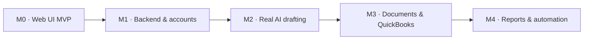

# Grantit roadmap

Feature map of Grantit, from the web UI MVP onward. GitHub issues are the source of truth; Linear mirrors them
through GitHub Issues Sync, in the Linear project "Grantit". Generated from `scripts/backlog/backlog.json` with
`node scripts/backlog/create-issues.mjs --roadmap`. Priorities match [requirements.md](requirements.md).

## M0 · Web UI MVP

Clickable web UI on demo data: every requirement marked built in docs/requirements.md.

### ✅ Web UI MVP

Requirements already built in the clickable web UI (demo data in the browser, no backend). Each sub-issue is one requirement from `docs/requirements.md`, closed as done. Real persistence and the live AI service are tracked in the M1–M4 epics.

| Priority | Issue | Requirement | Area |
|---|---|---|---|
| P0 | ✅ Store an organization's mission, programs, services, beneficiaries, and measurable outcomes | knowledge base |  |
| P0 | ✅ Allow staff to add, edit, and approve organizational facts | knowledge base |  |
| P0 | ✅ Generate application responses using only approved organizational facts | knowledge base |  |
| P0 | ✅ Show which stored facts support each generated response | knowledge base |  |
| P1 | ✅ Identify missing information rather than inventing it | knowledge base |  |
| P0 | ✅ Create and manage individual grant records | grant setup |  |
| P0 | ✅ Define a unique set of application questions for each grant | grant setup |  |
| P0 | ✅ Configure individual word limits for every question | grant setup |  |
| P0 | ✅ Define each grant's approved budget and spending categories | grant setup |  |
| P0 | ✅ Configure each grant's reporting year or funding period independently of the organization's fiscal year | grant setup |  |
| P1 | ✅ Store individual funder rules, restrictions, and reporting requirements | grant setup |  |
| P1 | ✅ Track application and reporting deadlines | grant setup |  |
| P1 | ✅ Support multiple simultaneous grants with different configurations | grant setup |  |
| P0 | ✅ Enforce each question's word limit automatically | AI drafting |  |
| P0 | ✅ Ensure generated statements are supported by approved information | AI drafting |  |
| P0 | ✅ Allow users to review, edit, approve, and regenerate answers | AI drafting |  |
| P1 | ✅ Validate completed applications for unanswered questions, unsupported claims, and exceeded word limits | AI drafting |  |
| P0 | ✅ Import a set of financial transactions, initially through CSV or sample QuickBooks data | accounting |  |
| P0 | ✅ Assign transactions to grants and approved spending categories | accounting |  |
| P0 | ✅ Calculate spending for each grant within its own funding period or fiscal year | accounting |  |
| P0 | ✅ Display approved budget, actual spending, and remaining balances for each category | accounting |  |
| P0 | ✅ Flag transactions assigned to unauthorized categories or exceeding approved category budgets | accounting |  |
| P1 | ✅ Detect categories approaching their spending limits | accounting |  |
| P1 | ✅ Allow staff to review and correct transaction classifications | accounting |  |
| P1 | ✅ Support allocating a transaction across multiple grants when permitted | accounting |  |
| P0 | ✅ Show a grant overview with its funding amount, spending, and remaining balance | dashboards & reports |  |
| P0 | ✅ Visualize expenditure by grant spending category | dashboards & reports |  |
| P0 | ✅ Display financial information using the funder's configured reporting period | dashboards & reports |  |
| P1 | ✅ Provide an organization-wide dashboard summarizing multiple grants | dashboards & reports |  |
| P1 | ✅ Track application status, deadlines, and reporting obligations | dashboards & reports |  |
| P1 | ✅ Generate grant-specific expenditure reports | dashboards & reports |  |
| P0 | ✅ Allow the director to configure grants, draft applications, and approve information | roles & workflow |  |
| P0 | ✅ Allow financial staff to review transactions, categories, and spending compliance | roles & workflow |  |
| P1 | ✅ Allow program staff to contribute and approve program information | roles & workflow |  |
| P1 | ✅ Track the status of applications, narrative drafts, financial checks, and reports | roles & workflow |  |

## M1 · Backend & accounts

Real persistence, sign-in, organizations and server-enforced roles. Replaces browser demo storage.

### Backend & persistence

The web app runs entirely on demo data in the browser (`web/src/store`, `web/src/data/seed.ts`). Add an API and database so organizations keep real data, without changing the UI.

| Priority | Issue | Requirement | Area |
|---|---|---|---|
| P0 | Decide backend stack and hosting (ADR) |  | backend |
| P0 | Database schema and migrations for the domain model |  | backend |
| P0 | REST API for grants, facts, questions and transactions |  | backend |
| P0 | Move the web store from browser storage to the API |  | backend |
| P0 | Server-side CSV transaction import | accounting | backend, finance |
| P0 | Deploy the API on 5820 with database backups |  | backend, ops |

### Accounts, organizations & roles

Roles (director, finance, program staff) are simulated in the UI with no sign-in. Add real accounts, organizations and server-enforced permissions.

| Priority | Issue | Requirement | Area |
|---|---|---|---|
| P0 | User sign-in | roles & workflow | auth |
| P0 | Organizations and team invites | roles & workflow | auth |
| P2 | Enforce role permissions on the server | roles & workflow | auth |
| P2 | Multi-user approval workflow for facts and answers | roles & workflow | auth, knowledge |

### Quality & operations

CI runs type-check, lint, unit tests and build. Add end-to-end coverage, monitoring and an accessibility pass.

| Priority | Issue | Requirement | Area |
|---|---|---|---|
| P1 | End-to-end tests for core flows |  | ops |
| P1 | Error monitoring for web and API |  | ops |
| P1 | Accessibility audit and fixes |  | ops |

## M2 · Real AI drafting

Swap the mock drafting engine for a grounded LLM service behind the DraftResult contract.

### Grounded AI drafting

`web/src/lib/drafting.ts` is a keyword-matching mock. Replace it with an LLM service that answers only from approved facts and returns the same `DraftResult` (text, citations, missing, blockedBy), so the UI doesn't change.

| Priority | Issue | Requirement | Area |
|---|---|---|---|
| P0 | Drafting service behind the DraftResult contract | AI drafting | ai |
| P0 | Validate citations and reject unsupported claims | AI drafting | ai |
| P0 | Enforce word limits on generated answers | AI drafting | ai |
| P1 | Report missing information instead of inventing it | knowledge base | ai |
| P0 | Grounding evaluation suite | AI drafting | ai, ops |
| P1 | Match the organization's tone and writing style | AI drafting | ai |
| P1 | Reuse relevant answers from past applications | AI drafting | ai |
| P1 | Usage limits and cost logging for drafting | AI drafting | ai, ops |

## M3 · Documents & QuickBooks

Upload past applications/reports, extract facts, and connect QuickBooks for transactions.

### Knowledge base documents

Past applications and reports are a list with no files, and the style profile is static. Store real documents and turn them into reviewable facts and a style profile.

| Priority | Issue | Requirement | Area |
|---|---|---|---|
| P1 | Upload past applications and reports | knowledge base | knowledge |
| P1 | Extract candidate facts from uploaded documents | knowledge base | knowledge, ai |
| P1 | Build a writing style profile from approved examples | knowledge base | knowledge, ai |

### QuickBooks & expenditure audit

Transactions come from CSV only. Connect QuickBooks Online and keep a full history of expenditure changes.

| Priority | Issue | Requirement | Area |
|---|---|---|---|
| P1 | Connect QuickBooks Online | accounting | finance |
| P1 | Sync QuickBooks transactions and map accounts to categories | accounting | finance |
| P2 | Audit trail for expenditure changes and approvals | accounting | finance |

## M4 · Reports & automation

Funder exports, auto-drafted reports, email alerts and an audit trail.

### Reports, exports & alerts

Reports export as CSV and alerts are in-app only. Add funder-ready exports, auto-drafted reports and email alerts.

| Priority | Issue | Requirement | Area |
|---|---|---|---|
| P2 | Export applications to DOCX and PDF | AI drafting | reports |
| P1 | PDF expenditure report per grant | dashboards & reports | reports |
| P2 | Auto-draft narrative and financial reports before deadlines | dashboards & reports | reports, ai |
| P2 | Email alerts for deadlines and projected overruns | dashboards & reports | reports |
