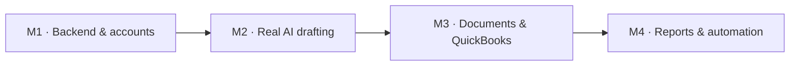

# Grantit roadmap

Feature map of the work after the web UI MVP. GitHub issues are the source of truth; Linear mirrors them
through GitHub Issues Sync. Generated from `scripts/backlog/backlog.json` with
`node scripts/backlog/create-issues.mjs --roadmap`. Priorities match [requirements.md](requirements.md).

## M1 · Backend & accounts

Real persistence, sign-in, organizations and server-enforced roles. Replaces browser demo storage.

### Backend & persistence

The web app runs entirely on demo data in the browser (`web/src/store`, `web/src/data/seed.ts`). Add an API and database so organizations keep real data, without changing the UI.

| Priority | Issue | Area |
|---|---|---|
| P0 | Decide backend stack and hosting (ADR) | backend |
| P0 | Database schema and migrations for the domain model | backend |
| P0 | REST API for grants, facts, questions and transactions | backend |
| P0 | Move the web store from browser storage to the API | backend |
| P0 | Server-side CSV transaction import | backend, finance |
| P0 | Deploy the API on 5820 with database backups | backend, ops |

### Accounts, organizations & roles

Roles (director, finance, program staff) are simulated in the UI with no sign-in. Add real accounts, organizations and server-enforced permissions.

| Priority | Issue | Area |
|---|---|---|
| P0 | User sign-in | auth |
| P0 | Organizations and team invites | auth |
| P2 | Enforce role permissions on the server | auth |
| P2 | Multi-user approval workflow for facts and answers | auth, knowledge |

### Quality & operations

CI runs type-check, lint, unit tests and build. Add end-to-end coverage, monitoring and an accessibility pass.

| Priority | Issue | Area |
|---|---|---|
| P1 | End-to-end tests for core flows | ops |
| P1 | Error monitoring for web and API | ops |
| P1 | Accessibility audit and fixes | ops |

## M2 · Real AI drafting

Swap the mock drafting engine for a grounded LLM service behind the DraftResult contract.

### Grounded AI drafting

`web/src/lib/drafting.ts` is a keyword-matching mock. Replace it with an LLM service that answers only from approved facts and returns the same `DraftResult` (text, citations, missing, blockedBy), so the UI doesn't change.

| Priority | Issue | Area |
|---|---|---|
| P0 | Drafting service behind the DraftResult contract | ai |
| P0 | Validate citations and reject unsupported claims | ai |
| P0 | Enforce word limits on generated answers | ai |
| P1 | Report missing information instead of inventing it | ai |
| P0 | Grounding evaluation suite | ai, ops |
| P1 | Match the organization's tone and writing style | ai |
| P1 | Reuse relevant answers from past applications | ai |
| P1 | Usage limits and cost logging for drafting | ai, ops |

## M3 · Documents & QuickBooks

Upload past applications/reports, extract facts, and connect QuickBooks for transactions.

### Knowledge base documents

Past applications and reports are a list with no files, and the style profile is static. Store real documents and turn them into reviewable facts and a style profile.

| Priority | Issue | Area |
|---|---|---|
| P1 | Upload past applications and reports | knowledge |
| P1 | Extract candidate facts from uploaded documents | knowledge, ai |
| P1 | Build a writing style profile from approved examples | knowledge, ai |

### QuickBooks & expenditure audit

Transactions come from CSV only. Connect QuickBooks Online and keep a full history of expenditure changes.

| Priority | Issue | Area |
|---|---|---|
| P1 | Connect QuickBooks Online | finance |
| P1 | Sync QuickBooks transactions and map accounts to categories | finance |
| P2 | Audit trail for expenditure changes and approvals | finance |

## M4 · Reports & automation

Funder exports, auto-drafted reports, email alerts and an audit trail.

### Reports, exports & alerts

Reports export as CSV and alerts are in-app only. Add funder-ready exports, auto-drafted reports and email alerts.

| Priority | Issue | Area |
|---|---|---|
| P2 | Export applications to DOCX and PDF | reports |
| P1 | PDF expenditure report per grant | reports |
| P2 | Auto-draft narrative and financial reports before deadlines | reports, ai |
| P2 | Email alerts for deadlines and projected overruns | reports |
